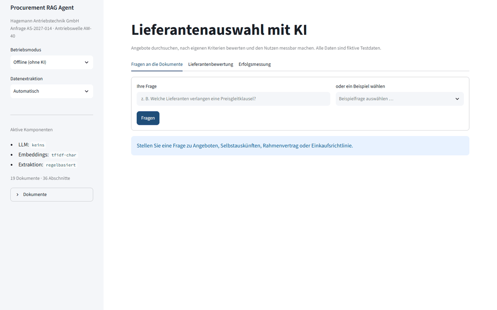
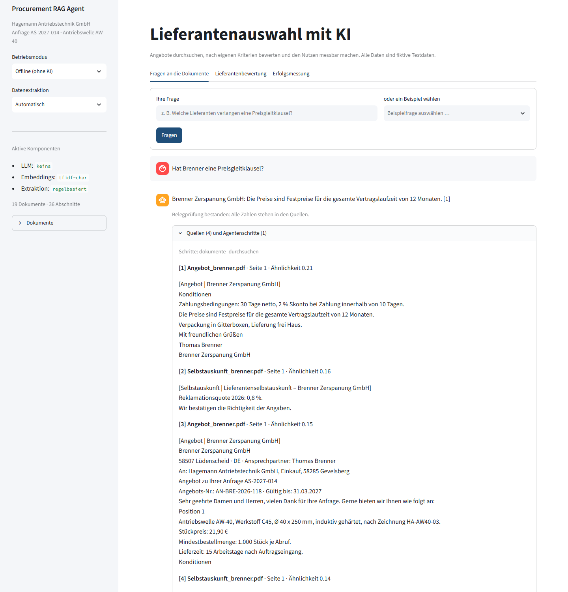
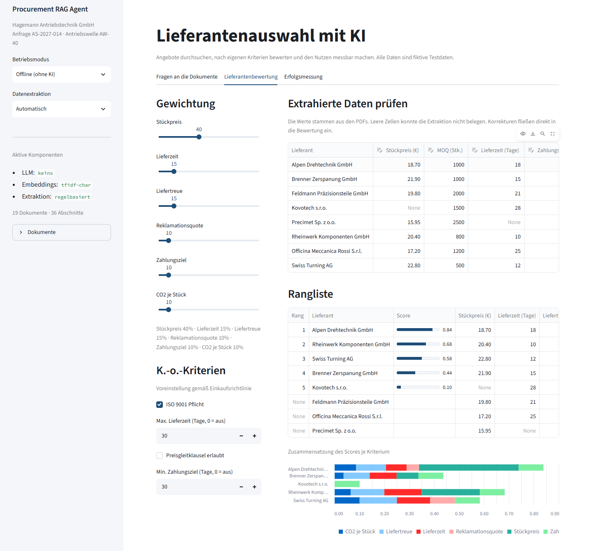
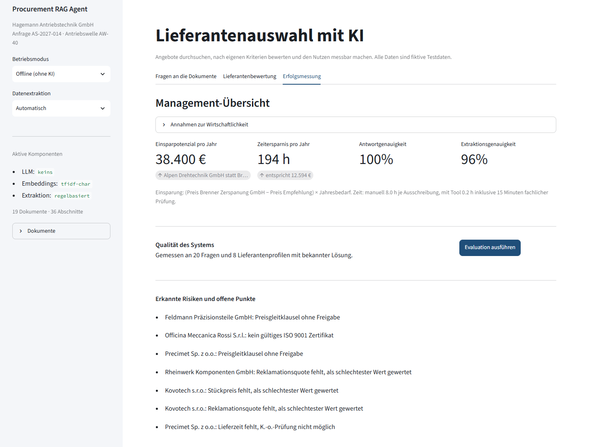
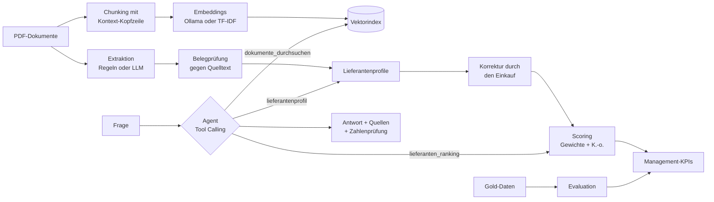

# Procurement RAG Agent – KI-gestützte Lieferantenauswahl

[](https://github.com/MaxXSammy/procurement-rag-agent/actions/workflows/ci.yml)

Ein Agent, der Lieferantenangebote, Selbstauskünfte und Verträge durchsucht, daraus strukturierte Profile extrahiert und Lieferanten nach frei einstellbaren Kriterien bewertet. Ein Dashboard zeigt der Geschäftsleitung, was das System leistet und wie zuverlässig es ist. Alles läuft lokal mit Ollama oder ganz ohne KI im Offline-Modus.



*Demo im Offline-Modus: Der Agent beantwortet eine Frage mit Quelle und Belegprüfung. Wird das Preisgewicht heruntergeregelt, rückt Swiss Turning auf Platz 1.*

## Das Problem

Bei einer Ausschreibung landen Angebote in unterschiedlichsten Formaten auf dem Tisch. Ein Lieferant nennt den Preis je 100 Stück, ein anderer die Lieferzeit in Wochen, ein dritter versteckt eine Preisgleitklausel im Kleingedruckten. Der Einkauf überträgt alles von Hand in eine Tabelle, prüft die Einkaufsrichtlinie und rechnet Szenarien durch. Das kostet pro Ausschreibung mehrere Stunden und ist fehleranfällig.

Gleichzeitig fragt die Geschäftsleitung zu Recht: Was bringt KI im Einkauf konkret, und kann man ihr trauen?

## Die Lösung

Die Oberfläche hat drei Bereiche:

| Bereich | Was er leistet |
|---|---|
| **Fragen an die Dokumente** | Ein Agent beantwortet Fragen mit Quellenangabe. Er entscheidet selbst, ob er Dokumente durchsucht, ein Ranking erstellt oder ein Lieferantenprofil abruft. |
| **Lieferantenbewertung** | Gewichte per Schieberegler, K.-o.-Kriterien aus der Einkaufsrichtlinie, extrahierte Werte im Tabelleneditor korrigierbar. Die Rangliste aktualisiert sich sofort. |
| **Erfolgsmessung** | Einsparpotenzial, Zeitersparnis und erkannte Risiken für die Geschäftsleitung, dazu die gemessene Qualität des Systems mit Verlauf. |

<details>
<summary><b>Screenshots der drei Bereiche</b></summary>

**Fragen an die Dokumente**: Antwort mit Quelle, Belegprüfung und den gefundenen Abschnitten



**Lieferantenbewertung**: Gewichte, K.-o.-Kriterien, korrigierbare Extraktion und Rangliste



**Erfolgsmessung**: Einsparpotenzial, Zeitersparnis, Systemqualität und erkannte Risiken



</details>

## Architektur



**Designentscheidungen**

- **Prüfung im Code statt Vertrauen ins LLM:** Jede extrahierte Zahl muss im Quelldokument stehen, gegebenenfalls nach einer erlaubten Umrechnung (je 100 Stück, Wochen, ppm). Sonst wird sie verworfen und als Warnung angezeigt. Auch in Antworten wird jede Zahl gegen die Quellen geprüft.
- **Mensch bleibt in der Schleife:** Extrahierte Werte lassen sich in der Oberfläche korrigieren, bevor sie in die Bewertung einfließen.
- **Kontext-Kopfzeilen beim Chunking:** Jeder Abschnitt trägt Dokumenttyp und Firmennamen. So findet die Suche „Stückpreis von Alpen“, obwohl der Firmenname nur oben im PDF steht.
- **Austauschbare Bausteine:** LLM, Embedder und Extraktor sind Protokolle. Ollama lässt sich durch ein anderes Modell ersetzen, ohne die Kernlogik anzufassen.
- **Offline-Modus als Basislinie:** TF-IDF-Suche, Regel-Extraktion und ein Regel-Router laufen ohne KI. So ist messbar, was das LLM tatsächlich verbessert.
- **Messbarkeit von Anfang an:** 20 Gold-Fragen und 8 Gold-Profile mit bekannter Lösung. Jede Evaluation wird protokolliert, damit Verbesserungen sichtbar werden.

## Erfolgsmessung

| Kennzahl | Bedeutung | Offline (ohne KI) | Ollama (qwen2.5:7b) ² |
|---|---|---|---|
| Retrieval-Trefferquote | erwartete Quelle unter den Top 4 | 95 % | 95 % |
| Antwortgenauigkeit | alle erwarteten Fakten in der Antwort | 100 % ¹ | 100 % |
| Belegquote | alle Zahlen der Antwort in den Quellen | 100 % | 100 % |
| Extraktionsgenauigkeit | korrekt extrahierte Profilfelder (88 Felder) | 96 % | 99 % |
| Ø Antwortzeit | je Frage, lokal | < 0,01 s | 1,3 s |

¹ Die Offline-Heuristik wurde an diesen Testdaten entwickelt. Der Wert ist deshalb optimistisch und kein Maßstab für fremde Dokumente.

² Gemessen mit LLM-Extraktion und LLM-Agent, aber TF-IDF-Suche, da das Embedding-Modell `nomic-embed-text` nicht installiert war. Die Retrieval-Trefferquote ist deshalb identisch mit dem Offline-Modus.

**Was die Messung gezeigt hat:** Der erste Lauf ergab nur 94 % Extraktionsgenauigkeit. Das Modell gab Reklamationsquoten wie „1,2 %“ als `0.012` aus. Die Belegprüfung hat diese Werte verworfen, statt sie ins Ranking zu übernehmen. Eine präzisere Feldregel im Prompt hob die Genauigkeit auf 99 %. Der verbleibende Fehler ist eine Angabe in ppm, die das 7B-Modell nicht zuverlässig umrechnet. Auch dieser Wert wird verworfen und als Warnung angezeigt.

**Geschäftskennzahlen mit den Standardannahmen:** Empfehlung Alpen Drehtechnik statt Bestandslieferant Brenner, rund **38.400 € Einsparpotenzial pro Jahr** bei 12.000 Stück. Dazu etwa **190 Stunden Zeitersparnis pro Jahr** bei 25 Ausschreibungen. Alle Annahmen stehen in `data/business.json` und lassen sich in der Oberfläche ändern.

## Testdaten

Alle Daten sind frei erfunden und werden von `scripts/generate_testdata.py` erzeugt. Eine einzige Faktenquelle im Skript erzeugt sowohl die PDFs als auch die Gold-Daten, damit beide garantiert zusammenpassen.

- **Ausschreibung** AS-2027-014 der fiktiven Hagemann Antriebstechnik GmbH: Antriebswelle AW-40, 12.000 Stück pro Jahr
- **8 Lieferanten** aus DE, CZ, PL, AT, IT und CH, jeweils mit Angebot und Selbstauskunft
- **Interne Dokumente:** Anfrage, Einkaufsrichtlinie, Rahmenvertrag mit dem Bestandslieferanten
- **Bewusst schwierige Formulierungen:** Preis je 100 Stück, Lieferzeit in Wochen, Reklamationen in ppm, ISO-Zertifizierung „in Vorbereitung“

## Tech-Stack

| Bereich | Technologie |
|---|---|
| Sprache | Python 3.12 |
| LLM und Tool Calling | Ollama mit qwen2.5:7b (lokal) |
| Embeddings | nomic-embed-text (Ollama) oder TF-IDF auf Zeichen-n-Grammen (scikit-learn) |
| Datenmodell und Structured Output | Pydantic, JSON-Schema |
| PDF | pypdf (lesen), reportlab (Testdaten) |
| Oberfläche | Streamlit |
| Qualität | pytest, Ruff, GitHub Actions |

## Installation

```bash
git clone https://github.com/MaxXSammy/procurement-rag-agent.git
cd procurement-rag-agent
python -m venv .venv
.venv\Scripts\activate          # Windows  |  source .venv/bin/activate (Linux/macOS)
pip install -r requirements.txt
```

Für den KI-Modus Ollama installieren und die Modelle laden:

```bash
ollama pull qwen2.5:7b
ollama pull nomic-embed-text
```

Ohne Ollama startet das System automatisch im Offline-Modus.

## Nutzung

```bash
streamlit run app.py                                   # Oberfläche
python -m procurement_agent frage "Welche Lieferanten verlangen eine Preisgleitklausel?"
python -m procurement_agent ranking                    # Rangliste im Terminal
python -m procurement_agent eval                       # Evaluation ausführen und protokollieren
python -m procurement_agent --offline eval             # Basislinie ohne KI
python scripts/generate_testdata.py                    # Testdaten neu erzeugen
```

Einstellungen wie Modell oder Modus stehen in `.env` (Vorlage: `.env.example`).

## Tests

```bash
pytest
```

Die Tests decken Dokumentenverarbeitung, Suche, Belegprüfung, beide Extraktoren, Scoring, Agentenlogik, Evaluation und die Oberfläche ab. Das LLM wird durch ein Fake-Objekt ersetzt, deshalb laufen alle Tests ohne Ollama und ohne GPU.

## Projektstruktur

```
procurement_agent/
├── config.py        # Einstellungen aus .env
├── documents.py     # PDFs laden, Chunking mit Kontext-Kopfzeile
├── retrieval.py     # Embedder (Ollama, TF-IDF) und Vektorsuche
├── llm.py           # LLM-Protokoll und Ollama-Anbindung
├── rag.py           # Antworten mit Quellen und Zahlenprüfung
├── extraction.py    # Lieferantenprofile: Regeln oder LLM, mit Belegprüfung
├── scoring.py       # Gewichtete Bewertung und K.-o.-Kriterien
├── agent.py         # Agent mit Tool Calling und Offline-Router
├── evaluation.py    # Qualitätskennzahlen, Geschäftskennzahlen, Verlauf
├── system.py        # Verdrahtung aller Bausteine
└── __main__.py      # Kommandozeile
app.py               # Streamlit-Oberfläche
scripts/             # Testdaten-Generator
data/                # PDFs, Gold-Daten, Business-Annahmen
docs/                # Demo-GIF und Screenshots für diese README
tests/               # pytest
```

## Bekannte Grenzen

- Die Gold-Daten sind klein (20 Fragen, 8 Profile) und selbst erzeugt. Sie zeigen das Vorgehen, ersetzen aber keine Evaluation mit echten Dokumenten.
- Die Belegprüfung erkennt erfundene Zahlen, aber keine falsch zugeordneten. Eine richtige Zahl beim falschen Lieferanten fällt nicht auf.
- Die Zahlenprüfung bei Antworten akzeptiert Zahlen, die irgendwo im Kontext stehen, auch wenn sie dort etwas anderes bedeuten.
- Der Vektorindex liegt im Arbeitsspeicher. Für tausende Dokumente wäre eine Vektordatenbank wie Chroma oder Qdrant sinnvoll.
- Das Einsparpotenzial vergleicht nur Stückpreise. Logistik-, Qualitäts- und Wechselkosten fließen nicht ein.

## Roadmap

- [x] Evaluation mit Ollama ausführen und Ergebnisse oben eintragen
- [ ] Evaluation mit Ollama-Embeddings (`nomic-embed-text`) wiederholen
- [ ] Total Cost of Ownership statt reinem Stückpreis
- [ ] Hybride Suche (BM25 + Embeddings) und Reranking
- [ ] Upload eigener Angebote in der Oberfläche
- [ ] Export der Entscheidungsvorlage als PDF für die Geschäftsleitung

## Lizenz

MIT, siehe [LICENSE](LICENSE).
